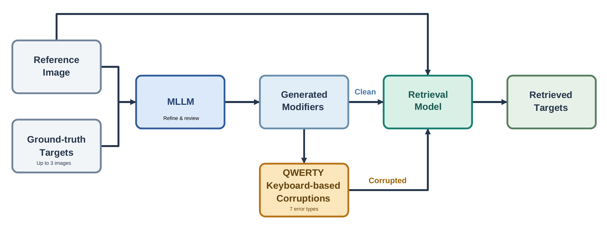

# RefinedGLAM4CIR

Inference-only refinement and robustness evaluation for cultural-heritage image retrieval.



*Qwen refines modifiers from a reference and up to three targets. Retrieval compares
clean modifiers with seven character/spacing corruptions.*

Install CUDA-compatible PyTorch/torchvision and configure paths and models in
[config.yaml](config.yaml):

```bash
pip install -r requirements.txt
python pipeline.py --split test_id --extractor openclip --seed 42 --gpu 0
# Both splits:
bash run_splits.sh config.yaml --extractor openclip --seed 42 --gpu 0
```

Uses existing `test_id`/`test_ood` triplets from `cir_db.csv` and local images
(default: `/data/data_fxu/GLAM/raw`). Retrieval always uses the full available
gallery and all available annotated targets.

- **Generate:** Qwen3-VL-8B compares a reference with up to three targets to produce
  a concise everyday-English modifier; only screened outliers receive review.
- **Corrupt:** Seven reproducible character/spacing errors, with severity quotas
  of 75% mild, 20% moderate, 4% severe, and 1% extreme.
- **Retrieve:** OpenCLIP, CLIP, or SigLIP2 (ViT-B/32); SigLIP is also supported.
  Image/text embeddings are normalized, added, and normalized again. The reference
  is excluded. TorchMetrics reports Recall, MRR, and mAP at K=1,5,10,50 and averages,
  including image-only, text-only, and image+text baselines.

Use `--stage data|generate|perturb|evaluate|visualize` for individual components;
`all` regenerates modifiers and runs everything. Model/seed-named JSONs, logs,
and PDF figures are saved in `outputs/<split>/`, ignored by Git.

```bash
python report_seeds.py --seeds 42 43 44  # Metrics: per-seed and mean/sample SD
python generation.py --seeds 42 43 44    # Modifier lengths, vocabulary, PDF word clouds
```

Both analysis commands accept `--extractor`.
