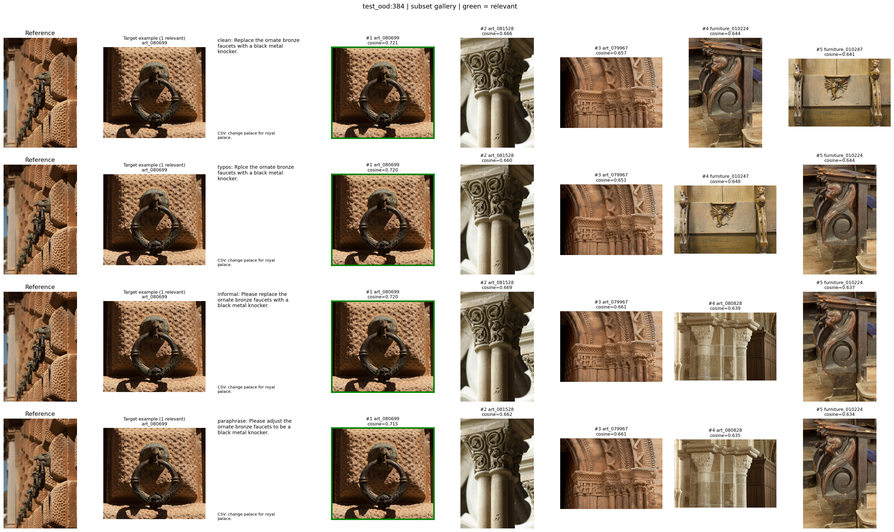

# GPU smoke experiment

GPU execution of the final scripts with resumable checkpoints on GPU 1 (NVIDIA RTX A6000), using Qwen2.5-VL-7B-Instruct and OpenCLIP ViT-B-16/OpenAI with QuickGELU.

Six category-balanced test_ood queries, 15 unique relevant targets, and a fixed 512-image subset gallery. All relevant targets were used for generation in this bounded smoke subset. The full split contains 22,373 available gallery images. These are target-conditioned, small-subset results, not full-benchmark results.

| Condition | Recall@1 | Recall@5 | Recall@10 | Recall@50 | mAP | MRR | AVG |
|---|---:|---:|---:|---:|---:|---:|---:|
| clean | 43.75 | 56.25 | 62.50 | 75.00 | 62.04 | 67.25 | 59.38 |
| typos | 43.75 | 56.25 | 62.50 | 75.00 | 62.67 | 67.18 | 59.38 |
| informal | 43.75 | 56.25 | 62.50 | 83.33 | 61.85 | 67.25 | 61.46 |
| paraphrase | 43.75 | 56.25 | 60.42 | 75.00 | 62.19 | 67.19 | 58.85 |

Values are percentages. Recall is macro multi-positive recall, not hit rate.

| Perturbation | Δ Recall@1 | Δ Recall@5 | Δ Recall@10 | Δ Recall@50 | Δ mAP | Δ MRR | Δ AVG |
|---|---:|---:|---:|---:|---:|---:|---:|
| typos | +0.00 | +0.00 | +0.00 | +0.00 | +0.63 | -0.07 | +0.00 |
| informal | +0.00 | +0.00 | +0.00 | +8.33 | -0.19 | -0.01 | +2.08 |
| paraphrase | +0.00 | +0.00 | -2.08 | +0.00 | +0.14 | -0.07 | -0.52 |

Deltas are perturbed minus clean in percentage points. Changes on six queries are descriptive and do not establish a general robustness effect.

The allowable function-word vocabulary was expanded during the run to accept harmless wording such as match/using; the manifest records the parameter revision. Existing accepted variants remain valid under the expanded vocabulary. Source code, models, clean modifiers and gallery were unchanged by this vocabulary update.

Thirteen correctness tests passed, Ruff passed, all scripts compiled, and the real GPU run completed generation, clean retrieval, 18 LLM perturbations with validation, paired evaluation, and three top-5 figures. The standalone visualization entry point was also checked.

Model-assisted review flagged two shared-target groups, and visual inspection identified further caption errors. See [quality inspection](quality_inspection.md); model acceptance is not independent validation.

Default wording variants protect complete visual phrases; typo edits are generated by the LLM for one selected word and applied only to that span. This is a conservative perturbation test. Full prompts, outputs, quality checks, per-query metrics, exact gallery membership, source hashes, model snapshot revisions and logs are saved alongside this report.

Reproduce on the server: `/home/fxu/my-env/bin/python run.py --stage all` from the repository. For a fresh run, set a new `paths.output_dir` in `config.yaml`. For the full split, remove the query/target-count/gallery subset limits as documented in the README.
